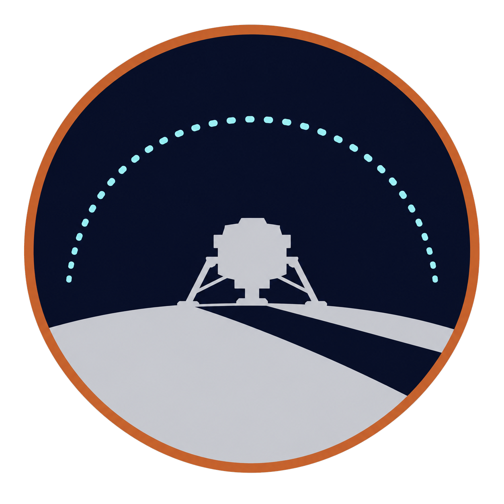
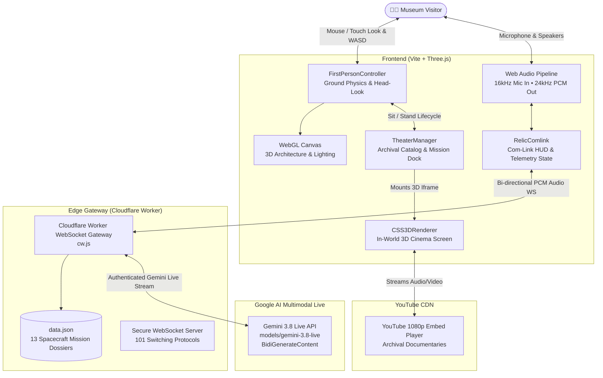

# 🌌 NASA Space Museum — "Abandoned but not Forgotten"

<p align="center">
  
</p>

<p align="center">
  <b>A 3D First-Person Virtual Museum Honoring NASA's Historic Spacecraft Relics on the Moon, Mars & Deep Space.</b><br />
  Featuring <b>Real-Time Bidirectional Voice Com-Links</b> powered by Google Gemini 3.8 Multimodal Live API<br />
  and an <b>In-World 3D Archival Cinema Theatre</b> streaming 1080p NASA documentaries on the auditorium wall.
</p>

<p align="center">
  
  
  
  
</p>

---

## 🚀 Overview

For over sixty years, humanity has sent robotic pioneers and lunar modules into the cosmos. While their missions have ended and their batteries have gone dark, their scientific triumphs and physical monuments remain resting silently in lunar moondust, Martian valleys, and deep asteroid fields.

**Space Museum** brings these historic machines back to life. Visitors walk freely through an architectural museum biodome in first-person, approach spacecraft exhibition platforms, and **open a direct two-way voice channel to talk with the machines themselves**. 

Whenever you want to sit back and learn, step into the **Documentary Theatre Auditorium**, take a seat in a velvet cinema chair, and watch authentic NASA archival films streamed directly onto the massive 3D screen mounted on the auditorium wall.

---

## ✨ Key Features

### 🎙️ 1. Direct Voice Com-Link (Gemini 3.8 Multimodal Live Engine)
- **Bidirectional Conversational Audio**: Talk naturally into your microphone and hear the spacecraft speak back in real time with low latency.
- **First-Person Spacecraft Personas**: Each machine speaks in the first person ("I landed in Meridiani Planum in 2004..."), imbued with emotional warmth, mission telemetry, and humility.
- **Custom Voice Profiles**: Tailored voice timbres and cadences matching the spacecraft's character (e.g. *Charon* for Apollo & Pioneer, *Aoede* for Spirit & Opportunity, *Puck* for Ingenuity & Sojourner, *Kore* for InSight & Viking).
- **Natural Barge-In & Interruption**: Speak at any moment while a spacecraft is answering to interrupt or ask a follow-up question naturally.
- **Secure Cloudflare Gateway**: Client Web Audio streams 16kHz PCM audio through a secure Cloudflare Worker WebSocket proxy—protecting Gemini API keys with zero browser credential exposure.

### 🎬 2. In-World 3D Archival Cinema Theatre (CSS3DRenderer)
- **Real In-World 3D Screen Projection**: Using Three.js `CSS3DRenderer` and `CSS3DObject`, 1080p YouTube documentaries render directly onto the $3.90\text{m} \times 2.10\text{m}$ screen on the physical auditorium wall.
- **Unobstructed 3D Cinema Experience**: When seated in any of the 15 luxury chairs across 3 stepped tiers, the auditorium lights smoothly dim to black, with full 360° head-turning freedom.
- **Low-Profile Cinema Mission Dock**: A sleek bottom shelf with 16:9 widescreen YouTube thumbnails, celestial target tags, and category pills (*Mars*, *Moon*, *Asteroids*, *Deep Space*).
- **12 Curated Archival Films**: Documenting missions from Apollo lunar modules and Surveyor landers to Spirit & Opportunity, InSight, Dawn, and Kepler.

### 🏛️ 3. Monumental 3D Museum Architecture (Three.js WebGL)
- **Architectural Open-Air Pavilion**: Custom architectural complex with courtyard exhibition platforms, dynamic perimeter lighting, and skylight biodome.
- **Collision Physics & Ground Detection**: Realistic human-scale walking, step climbing, wall collision damping, and procedural footstep audio.
- **Spectator Drone Flight Mode**: Press `[G]` at any time to toggle free-flight drone mode and soar through the museum rafters.
- **Interactive Floor Map**: Real-time architectural blueprint for instantaneous sector teleportation and orientation.

---

## 📡 System Architecture



---

## 🤖 Spacecraft Voice Roster & Exhibit Dossiers

| Spacecraft | Target Location | Mission Era | Voice | Character Demeanor |
| :--- | :--- | :--- | :--- | :--- |
| **Apollo 11 LM (Eagle)** | Moon • Sea of Tranquility | 1969 | `Charon` | Calm, resonant, historic vintage NASA radio cadence |
| **Apollo 12 LM (Intrepid)** | Moon • Ocean of Storms | 1969 | `Charon` | Steady, proud lunar explorer alongside Surveyor 3 |
| **Apollo 15 LM (Falcon)** | Moon • Hadley Rille | 1971 | `Charon` | Enthusiastic veteran, proud of driving the first Lunar Rover |
| **Surveyor 3** | Moon • Ocean of Storms | 1967 | `Kore` | Gentle, solitary robotic scout visited by Apollo 12 |
| **Mars Pathfinder / Sojourner** | Mars • Ares Vallis | 1996 – 1997 | `Puck` | Spunky, daring, adventurous pioneer micro-rover |
| **Spirit & Opportunity (MER)** | Mars • Meridiani Planum | 2003 – 2018 | `Aoede` | Warm, deeply nostalgic rover; 15 years & 45 km on Mars |
| **Viking 1 Lander** | Mars • Chryse Planitia | 1975 – 1982 | `Kore` | Dignified, analytical pioneer of the Martian surface |
| **InSight Lander** | Mars • Elysium Planitia | 2018 – 2022 | `Kore` | Meditative, quiet listener of marsquakes and interior pulses |
| **Dawn Spacecraft** | Vesta & Ceres Protoplanets | 2007 – 2018 | `Aoede` | Majestic ion-propulsion voyager of the deep Asteroid Belt |
| **Ingenuity Mars Helicopter** | Mars • Jezero Crater | 2020 – 2024 | `Puck` | High-spirited aerial scout; 72 flights in Martian skies |
| **Kepler Space Telescope** | Deep Space • Cygnus/Lyra | 2009 – 2018 | `Aoede` | Awe-inspired gazer; discoverer of 2,600+ alien worlds |
| **NEAR Shoemaker** | Asteroid 433 Eros | 1996 – 2001 | `Fenrir` | Bold, daring pioneer resting on an asteroid surface |
| **Pioneer 10 & 11** | Outer Solar System / Deep Void | 1972 – 2003 | `Charon` | Solemn interstellar traveler carrying humanity's Golden Plaque |

---

## 🎞️ Archival Documentary Cinema Catalog

When seated in the movie theatre auditorium, visitors can select and screen any of the 12 curated historical documentaries on the auditorium screen:

1. `gaM1GDUOO9A`: **NEAR Shoemaker** — The First Spacecraft to Land on an Asteroid (Eros)
2. `Dv9_P2TsoaU`: **NASA Dawn Mission** — Vesta & Ceres Protoplanets
3. `_2IjXlKj5kw`: **Phoenix & InSight** — NASA's Mars Landers & Marsquakes
4. `BoI1B4_2XnU`: **Viking 1 & 2** — First Successful Surface Operations on Mars
5. `KV8etrzverU`: **Spirit & Opportunity** — 15 Years on the Red Planet
6. `9RhaBzn8yyQ`: **Mars Pathfinder & Sojourner** — First Mobile Mars Rover
7. `BGJ3oYD4K-k`: **ALSEP** — Apollo Lunar Surface Experiments Package
8. `q3fE2EbRTEw`: **Apollo Lunar Modules** — Monuments in Moondust
9. `8Zgv1iVY1kc`: **Surveyor Landers** — Precursor Moon Explorers
10. `-YMSF0f8nTI`: **Kepler Space Telescope** — Hunting Alien Worlds
11. `69FTSCsHybA`: **Ingenuity Mars Helicopter** — First Flight on Mars
12. `3e8GQDRC7-U`: **Pioneer 10 & 11** — Journey into the Deep Unknown

---

## 🎮 Controls & Keybindings

| Key / Input | Action | Mode |
| :--- | :--- | :--- |
| **`W` `A` `S` `D`** | Move Forward / Left / Backward / Right | Walking / Seated |
| **`Shift`** | Sprint / Accelerated Movement | Walking / Flight |
| **`Mouse Move` / `Drag`** | Look around (Full 360° Pitch & Yaw) | Walking / Seated |
| **`E`** | **Interact**: Talk to Spacecraft / Sit in Chair / Stand Up | Any |
| **`M`** | Open / Close Cinema Mission Documentary Dock | Seated in Theatre |
| **`G`** | Toggle Free-Flight Developer Drone Mode | First-Person |
| **`Space`** | Ascend in Flight Mode / Stand Up when Seated | Flight / Seated |
| **`C`** | Descend in Flight Mode | Flight |
| **`Esc`** | Exit to Orbit View / Close Modal | Any |
| **`Gamepad Left Stick`** | Analog Walking Movement | Gamepad |
| **`Gamepad Right Stick`** | Smooth Camera Look Rotation | Gamepad |
| **`Gamepad (A) / (X)`** | Interact with Spacecraft / Sit in Seat | Gamepad |

---

## 🛠️ Project Structure

```
Space-Museum/
├── Backend/
│   └── Cloudlfare/
│       ├── cw.js            # Cloudflare Worker WebSocket Gateway for Gemini Live
│       ├── data.json        # 13 Historical Spacecraft Mission Telemetry Dossiers
│       ├── package.json     # Wrangler & Node dependencies
│       └── wrangler.toml    # Worker deployment configuration & env bindings
├── Frontend/
│   └── Space-Museum/
│       ├── public/          # 3D models (glb/obj), posters & textures
│       ├── src/
│       │   ├── Logic/
│       │   │   ├── theater.js            # In-World 3D Cinema Screen & Mission Dock
│       │   │   ├── map-selector.js       # Architectural Blueprint & Teleportation
│       │   │   ├── loa_modle.js          # 3D Model Loading & Geometry Centering
│       │   │   ├── intro.js              # Atmospheric Orbit-to-Surface Landing
│       │   │   ├── gamepad.js            # Full Gamepad Controller API
│       │   │   └── AI/
│       │   │       ├── relic-comlink.js  # Gemini 3.8 Live Voice Com-Link Engine
│       │   │       └── ME/
│       │   │           └── nevigation.js # Player Physics, Ground Collision & HUD
│       │   ├── Ui/
│       │   │   ├── theatre.js            # 3D Auditorium, Stepped Risers & Chairs
│       │   │   ├── exhibition-platforms.js # 13 Rover Courtyard Podia
│       │   │   ├── posters.js            # Corridor Historical Artwork Plaques
│       │   │   ├── road-light.js         # Floor Pathway LED Lighting
│       │   │   ├── dome.js               # Skybox, Nebula & Celestial Domes
│       │   │   └── style.css             # Sci-Fi Glassmorphism Stylesheet
│       │   ├── main.js                   # Application Entry & Render Loop
│       │   └── index.html                # HTML Root & Canvas
│       └── package.json                  # Vite & Three.js Dependencies
└── Meta/
    ├── hand_book.md         # Exhaustive Development Logbook (Logs 1–114)
    ├── stuff.md             # Technical Audit & Architecture Blueprints
    └── Problem-statement.md # NASA Space Apps Challenge 2026 Guidelines
```

---

## 💻 Local Setup & Development

### Prerequisites
- Node.js `v18+` or `v20+`
- npm or pnpm
- Google Gemini API Key (with Gemini Multimodal Live API access)
- Cloudflare Wrangler CLI (`npm i -g wrangler`)

### 1. Clone the Repository
```bash
git clone https://github.com/ARNAB9669/SpaceMuseum-.git
cd SpaceMuseum-/Space-Museum
```

### 2. Run the Frontend Development Server
```bash
cd Frontend/Space-Museum
npm install
npm run dev
```
Open [http://localhost:5173](http://localhost:5173) in your browser.

### 3. Deploy / Run the Cloudflare Worker Gateway
```bash
cd ../../Backend/Cloudlfare
npm install

# Test locally with Wrangler
npx wrangler dev

# Or deploy directly to Cloudflare edge network
npx wrangler deploy
```

Configure your `wrangler.toml` or set secrets via:
```bash
npx wrangler secret put GEMINI_API_KEY
```

---

##  NASA Space Apps Challenge 2026

**Challenge Topic**: *"Abandoned but not Forgotten: Storytelling about NASA's Discarded Equipment on the Moon and Mars"*

This project reimagines how humanity interacts with space history:
- Rather than reading static museum placards, visitors engage in **spoken dialogue** with the spacecraft itself.
- Highlighting the scientific discoveries, harsh environments, and poignant end-of-mission stories of humanity's greatest explorers.
- Preserving space heritage through high-fidelity interactive WebGL and cutting-edge generative AI.

---

## 👥 Meet the Team

### Arnab Biswas
**Full-Stack Developer**  
Created the interactive 3D space exploration game for Space Museum.  
Email: [arnabbiswas9669@gmail.com](mailto:arnabbiswas9669@gmail.com)

### Rajdeep Das
**Frontend Developer**  
Builds the front-end of Space Museum, shaping how visitors interact with the project.  
Email: [das.rajdeepofficial2007@gmail.com](mailto:das.rajdeepofficial2007@gmail.com)

### Tanmay Singh Jadaun
**Video Editor**  
Made the Introductory video for Space Museum and tells the project's story.  
Email: [tanmayjadaun030@gmail.com](mailto:tanmayjadaun030@gmail.com)

### Swayamdeep Pathak
**Graphic Designer & Content Coordinator**  
Designed the logo for Space Museum, and researched for spacecraft.  
Email: [swayam.mission@gmail.com](mailto:swayam.mission@gmail.com)

### Jaideep Singh
**Data Analyst & Data Manager**  
Analyzes and organizes mission data to support the museum's stories.  
Email: [jaideep345r@gmail.com](mailto:jaideep345r@gmail.com)

### Satej Kumar Sen
**Rover & Space Equipment Researcher**  
Researches rovers and space equipment for the museum's exhibits.  
Email: [hyperx44444@gmail.com](mailto:hyperx44444@gmail.com)

---

## 🛰️ Technologies & Acknowledgments

- **Technologies**: Google DeepMind (Gemini 3.8 Multimodal Live API), Three.js, Autodesk Fusion 360, Cloudflare Workers, NASA Open Data & Treks.
- **Challenge**: NASA Space Apps Challenge 2026 — *"Abandoned but not Forgotten"*

<p align="center">
  <i>"Here Men from the Planet Earth First Set Foot Upon the Moon. We Came in Peace for All Mankind."</i>
</p>
